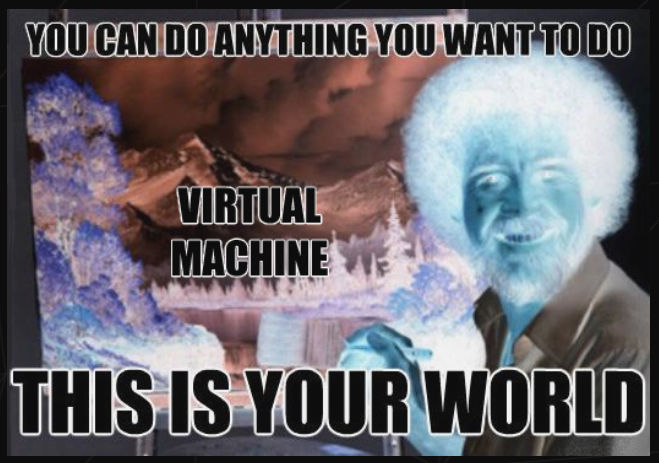

**Note** : If you found this repo you should stop for a second and [read this](https://atomys.me/en/s42-sunset-story/)

# Born2beRoot 󰹑

> an introduction to _**the wonderful world of virtualization**_.

    
    
    

# About

This project teaches how to setup a server implementing strict rules. 

To complete this project a **Virtual Machine** (using **VirtualBox** or **UTM**) must be built following specific instructions.

___

## [Subject Requirements](SUBJECT.md)

## [Guide](GUIDE.md)

## [Commands Glossary](COMMANDS.md)

### License :copyright:

This work is published under the terms of <a href="https://github.com/PedroZappa/ft_printf/blob/master/LICENSE">42 Unlicense</a>.

(<a href="#readme-top">get to top</a>)

